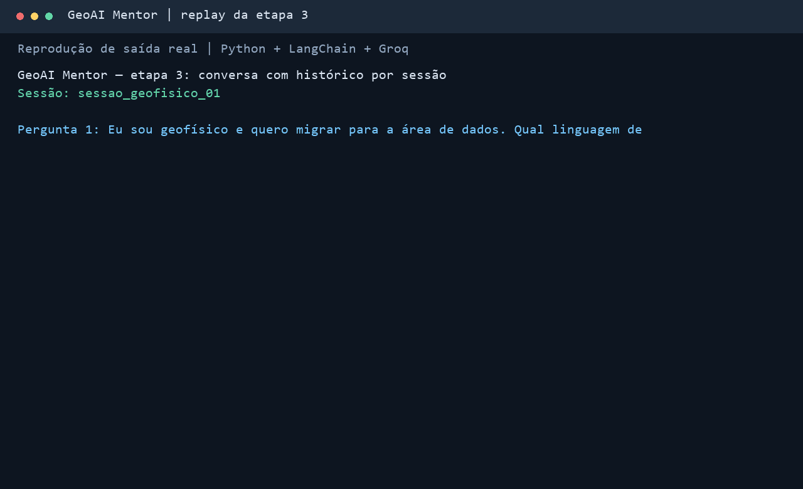
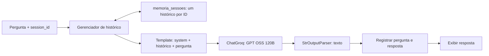

# GeoAI Mentor

Chatbot de mentoria para profissionais de Geociências que querem migrar para
Ciência de Dados e Inteligência Artificial. Projeto desenvolvido por etapas
como desafio de estudo da Alura.

Usa **Python, LangChain e a API da Groq**, com `openai/gpt-oss-120b`.
A Groq substitui a API da OpenAI apresentada no enunciado. Não é necessário
configurar uma chave da OpenAI.

## Demonstração



A animação reproduz no formato de terminal a saída real já capturada; não é
uma gravação de tela. Os registros completos estão em [exemplos](exemplos/).

## Executar

Ambiente validado: **Python 3.13.2**. É necessário ter uma chave da Groq.
O acesso depende dos limites e da disponibilidade da conta utilizada.

No PowerShell:

```powershell
git clone https://github.com/vitorlimeira22/geoai-mentor.git
cd geoai-mentor
py -3.13 -m venv .venv
.\.venv\Scripts\python.exe -m pip install -r requirements.txt
Copy-Item .env.example .env
```

Abra `.env` no editor e preencha localmente:

```dotenv
GROQ_API_KEY=sua_chave_da_groq
```

Depois execute:

```powershell
.\.venv\Scripts\python.exe chatbot_mentor.py
```

O programa envia duas perguntas de demonstração e encerra. Não é uma interface
interativa. O `.env` ao lado do script é carregado, preservando variáveis de
ambiente existentes. O `.env` real e o ambiente virtual são ignorados pelo Git;
apenas `.env.example`, sem credenciais, é versionado.

## Etapas preservadas

| Arquivo | O que demonstra |
| --- | --- |
| [chatbot_mentor_etapa1.py](chatbot_mentor_etapa1.py) | Perguntas independentes enviadas diretamente ao modelo. |
| [chatbot_mentor_etapa2.py](chatbot_mentor_etapa2.py) | Persona, template e cadeia LCEL; histórico vazio. |
| [chatbot_mentor.py](chatbot_mentor.py) | Histórico automático por sessão envolvendo a cadeia da etapa 2. |

Para executar uma etapa anterior, troque o nome do arquivo no comando.
O [guia didático](docs/GUIA_DIDATICO.md) explica cada parte do código.

## Arquitetura e sessões



`RunnableWithMessageHistory` busca o histórico pelo `session_id`, insere as
mensagens em `{historico}` e registra o novo turno. A cadeia interna é
`prompt | modelo | StrOutputParser()`.

| ID escolhido pelo programa | Histórico recuperado |
| --- | --- |
| `conversa_a` novamente | As mensagens já guardadas de `conversa_a`. |
| `conversa_b` pela primeira vez | Um novo histórico vazio. |

O ID identifica uma conversa; uma pessoa pode ter várias. A mensagem `system`
vem do template em cada chamada. A memória fica na RAM: fechar o programa apaga
os históricos. Em nova execução, até o mesmo ID começa sem mensagens.

## Antes e depois

Pergunta inicial: “Eu sou geofísico e quero migrar para a área de dados. Qual
linguagem de programação devo aprender primeiro?” Nas execuções registradas,
o modelo recomendou Python.

Pergunta seguinte: “E que tipo de projeto de portfólio eu poderia criar usando
essa linguagem?”

| Execução real | Contexto enviado na segunda chamada | Projeto sugerido |
| --- | --- | --- |
| Etapa 1 | Apenas a pergunta 2. | Dashboard de COVID-19. |
| Etapa 2 | Orientações do mentor + pergunta 2. | Análise de dados sísmicos. |
| Etapa 3 | Orientações + pergunta 1 + resposta 1 + pergunta 2. | Detecção de eventos sísmicos em Python. |

Uma resposta plausível, por si só, não comprova memória. Os testes conferem as
mensagens entregues ao modelo. Os textos variam por execução; as sugestões são
exemplos de saída, não instruções técnicas validadas deste projeto.

- [Diálogo sem histórico](exemplos/etapa_1_sem_memoria.md)
- [Diálogo com persona e histórico vazio](exemplos/etapa_2_persona_sem_memoria.txt)
- [Diálogo com histórico](exemplos/etapa_3_com_memoria.txt)
- [Visual da etapa 1](docs/images/etapa_1_sem_memoria.png) e [visual da etapa 3](docs/images/etapa_3_com_memoria.png)

## Verificações

```powershell
.\.venv\Scripts\python.exe -m pip check
.\.venv\Scripts\python.exe -m unittest discover -s tests -v
```

Os três testes usam um modelo simulado e não precisam de chave ou de API.
Verificam reutilização do histórico, reenvio do turno anterior sem duplicar a
pergunta atual e separação de sessões. As três etapas também foram executadas
com sucesso na Groq; os registros estão em `exemplos/`.

As classes de histórico emitem avisos de descontinuação na versão fixada do
LangChain. Foram mantidas para seguir o desafio. A evolução recomendada é a
[persistência com LangGraph](https://docs.langchain.com/oss/python/langchain/short-term-memory).
O projeto atual não usa LangGraph nem armazenamento de conversas em disco.

## Material de estudo e entrega

- [Guia detalhado das três etapas](docs/GUIA_DIDATICO.md)
- [Revisão dos requisitos dos prints](docs/REVISAO_DESAFIO.md)
- [Relato de aprendizado para revisar e compartilhar](docs/RELATO_APRENDIZADO.md)

Para regenerar os visuais, instale `requirements-dev.txt` no ambiente virtual e
execute `scripts/gerar_demo.py`. A geração usa os registros existentes, sem API.
